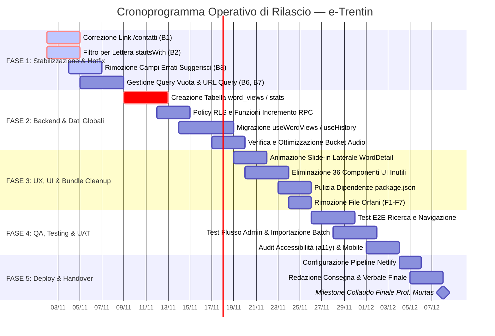

# Pacchetto Integrato di Documentazione e Governance di Progetto
## Progetto: e-Trentin (Parole Trentine — FORC-FACCHINELLI)
**Istituto:** ITT "M. Buonarroti", Trento — Indirizzo Informatica  
**Supervisore Didattico:** Prof. Murtas  
**Consulenza Linguistica:** Prof.ssa Patrizia Cordin (UniTN)  
**Versione Documento:** 1.0 (Master Release)  
**Data:** Anno Scolastico 2025/2026 — Sessione Operativa Autunno 2026  

---

## Indice Generale dei Documenti
1. [Project Charter & Visione Strategica](#1-project-charter--visione-strategica)
2. [Cronoprogramma Operativo & Diagramma di Gantt](#2-cronoprogramma-operativo--diagramma-di-gantt)
3. [Piano Operativo di Consegna (Deliverables Plan & DoD)](#3-piano-operativo-di-consegna-deliverables-plan)
4. [Matrice RACI dei Ruoli e Responsabilità](#4-matrice-raci-dei-ruoli-e-responsabilit%C3%A0)
5. [Registro Rischi, Criticità Tecniche & Piani di Risoluzione (Risk & Issue Log)](#5-registro-rischi-criticit%C3%A0-tecniche--piani-di-risoluzione)
6. [Kit Modulistica di Governance (SAL & Verbali di Riunione)](#6-kit-modulistica-di-governance)
7. [Script per Audio-Briefing Esecutivo (Voiceover & Podcasting)](#7-script-per-audio-briefing-esecutivo)

---

# 1. Project Charter & Visione Strategica

### 1.1 Executive Summary e Valore del Progetto
Il progetto **e-Trentin** scaturisce dall'esigenza culturale e didattica di salvaguardare, valorizzare e modernizzare il patrimonio dialettale e lessicale trentino attraverso un'applicazione web accessibile, performante e multi-piattaforma. I dizionari cartacei tradizionali (come il vocabolario del dialetto trentino di Vittorio Dal Rì e l'opera di Patrizia Cordin) presentano barriere di fruizione per le nuove generazioni. **e-Trentin** abbatte tali barriere offrendo un dizionario digitale indicizzato, ricerca istantanea bidirezionale (Trentino ↔ Italiano), campionamenti audio delle pronunce originali e un meccanismo di crowdsourcing moderato per la raccolta di nuovi vocaboli.

### 1.2 Obiettivi SMART
- **S (Specific):** Rilasciare un'applicazione web responsive completa, priva di bug bloccanti, con sistema di autenticazione per l'amministrazione, gestione dei contributi utente e riproduzione audio.
- **M (Measurable):** Tempo di risposta della ricerca < 50ms (in-memory caching), punteggio Lighthouse > 90 su Performance, Accessibilità e SEO; 0 errori di console a runtime; 100% dei link e percorsi di navigazione verificati.
- **A (Achievable):** Architettura decoupled basata su React 18, Vite, TypeScript, Tailwind CSS, shadcn/ui e Supabase (PostgreSQL + RLS + Storage).
- **R (Relevant):** Digitalizzazione e preservazione del dialetto a supporto sia del pubblico generico che del contesto accademico e scolastico locale.
- **T (Time-bound):** Completamento della stabilizzazione, del refactoring e del collaudo finale entro 6 settimane operative.

### 1.3 Ambito di Progetto (Scope Management)

#### In-Scope:
- Ricerca lessicale bidirezionale (prefisso, sottostringa, categoria grammaticale, lettera iniziale).
- Scheda parola ricca: trascrizione fonetica, etimologia, esempi contestuali, sinonimi/contrari e audio nativo.
- Back-office amministrativo protetto da Role-Based Access Control (RBAC via RLS Supabase) per moderazione suggerimenti, gestione manuale ed importazione massiva via fogli di calcolo Excel/CSV.
- Centralizzazione su database delle parole più cercate (migrazione da archiviazione effimera locale su browser).
- Ottimizzazione bundle frontend: eliminazione radicale di 36 componenti UI non utilizzati, file di test o di simulazione orfani.

#### Out-of-Scope (Fase Corrente):
- Sintesi vocale dinamica AI automatica (le registrazioni restano affidate a campionamenti umani convalidati).
- Forum aperto di discussione o social networking tra utenti.
- Distribuzione su store nativi iOS/Android (la piattaforma adotta approccio Responsive Web App nativo).

---

# 2. Cronoprogramma Operativo & Diagramma di Gantt

Il cronoprogramma è articolato in **5 Fasi Operative** per una durata complessiva di 6 settimane lavorative (Sprint di 7-10 giorni).



### 2.1 Tabella Dettagliata delle Milestone e Scadenze

| Milestone | Descrizione Operativa | Data Scadenza | Deliverable Principale | Dipendenze |
|---|---|---|---|---|
| **M1: Bugfree Core** | Chiusura dei bug funzionali bloccanti (B1, B2, B6, B7, B8) | Fine Settimana 1 | PR consolidata su branch `staging` | Nessuna |
| **M2: Data Persistence** | Schema Supabase per statistiche di visualizzazione globali | Fine Settimana 2 | Migrazione SQL 04 e hook frontend aggiornati | M1 |
| **M3: Clean & Sleek UI** | Refactoring componenti UI, drawer da destra, -40% peso bundle | Fine Settimana 3 | Build di produzione senza warning né dead-code | M1 |
| **M4: Validation & UAT** | Test utente, stress test batch import Excel (50+ voci), audit a11y | Fine Settimana 5 | Verbale di collaudo e regression test superato | M2, M3 |
| **M5: Final Production** | Rilascio su Netlify con custom domain, consegna documentazione | Fine Settimana 6 | Progetto in produzione + Documentazione approvata | M4 |

---

# 3. Piano Operativo di Consegna (Deliverables Plan)

Ogni deliverable deve rispettare severi criteri di qualità definiti nella **Definition of Done (DoD)**:
1. Codice privo di errori di compilazione TypeScript (`tsc --noEmit`).
2. Assenza di warning ESLint.
3. Test manuale eseguito e documentato su desktop e mobile (iOS Safari / Android Chrome).
4. Peer-review approvata prima del merge su `main`.

### 3.1 Dettaglio Consegne per Categoria

```
DELIVERABLE PACK: e-Trentin
├── [DEL-01] Software & Piattaforma Web
│   ├── Frontend React 18 / Vite / TypeScript ottimizzato
│   ├── Sistema di Routing dinamico con supporto query string
│   └── Pannello Amministrativo con visualizzatore e editor
├── [DEL-02] Database & Infrastruttura Cloud
│   ├── Script di migrazione SQL consolidati (01, 02, 03, 04)
│   ├── Configurazione RLS e ruoli amministrativi blindati
│   └── Bucket di storage audio configurato per file .mp3 / .wav
├── [DEL-03] UI Kit & Design System
│   ├── Configurazione Tailwind CSS e temi standardizzati
│   ├── Drawer laterale contestuale animato per il dettaglio parola
│   └── Asset grafici e loghi istituzionali ottimizzati (WebP/SVG)
├── [DEL-04] Documentazione di Progetto & Didattica
│   ├── Relazione Tecnica dettagliata
│   ├── Guida Amministratore e Guida Sviluppatore
│   └── Manuale d'Uso e schede di verifica UAT
└── [DEL-05] Asset Multimediali & Comunicazione
    ├── Audio-Briefing Esecutivo (registrazione vocale + script)
    └── Archivio file audio delle pronunce dialettali
```

---

# 4. Matrice RACI dei Ruoli e Responsabilità

### Legenda RACI:
- **R - Responsible (Esecutore):** Chi svolge materialmente il compito operativo.
- **A - Accountable (Approvatore / Responsabile unico):** Chi ha l'autorità finale di approvazione e risponde dell'esito.
- **C - Consulted (Consultato):** Chi viene consultato per pareri tecnici, specialistici o linguistici.
- **I - Informed (Informato):** Chi viene aggiornato sull'avanzamento dei lavori.

### Composizione del Team e Aree di Elezione:
- **Cristopher Facchinelli:** Project Leader Tecnico, Pannello Admin, Auth RBAC, Importazione Dati, Documentazione Tecnica.
- **Giacomello Fabio:** Data Engineer & Backend Lead, Schemi SQL Supabase, RLS, Storage Audio, API Client.
- **Emanuele Biasi:** Frontend Architect & Navigation Lead, Routing, State Management, Pagine pubbliche, SEO.
- **Prosser Davide:** UI/UX Lead & DevOps, Design System Tailwind, Performance, Build & Pipeline Netlify.
- **Prof. Murtas:** Supervisore Didattico / Committente di Progetto.
- **Prof.ssa Patrizia Cordin:** Consulente Linguistica e Lessicale Esterna.

### 4.1 Tabella della Matrice RACI

| Ambito / Deliverable Operativo | Facchinelli | Giacomello | Biasi | Prosser | Prof. Murtas | Prof.ssa Cordin |
|---|:---:|:---:|:---:|:---:|:---:|:---:|
| **Project Charter & Governance** | **A** | I | C | C | **C / Approva** | I |
| **Architettura DB & Migrazioni SQL** | C | **A / R** | I | I | I | I |
| **Storage Audio & Politiche RLS** | C | **A / R** | I | C | I | I |
| **Metriche Globali (Views & Stats DB)** | C | **A / R** | R | I | I | I |
| **Routing & Risoluzione Pagine / Link** | I | I | **A / R** | C | I | I |
| **Filtri di Ricerca e Search Bar** | C | C | **A / R** | C | I | C |
| **Pannello Admin & Gestione Suggerimenti** | **A / R** | C | I | I | C | I |
| **Batch Import Excel / CSV** | **A / R** | C | I | I | I | C |
| **UI Design System & Pulizia Componenti** | I | I | C | **A / R** | I | I |
| **Animazione Drawer & Scheda Parola** | I | I | C | **A / R** | I | I |
| **Validazione Lessicale dei Vocaboli** | C | I | I | I | I | **A / R** |
| **Pipeline CI/CD & Deploy Netlify** | C | I | I | **A / R** | I | I |
| **Testing, Collaudo & UAT** | R | R | R | R | **A** | C |
| **Relazione Finale & Audio-Briefing** | **A / R** | C | C | C | **A** | I |

---

# 5. Registro Rischi, Criticità Tecniche & Piani di Risoluzione

Dall'analisi meticolosa del repository e dall'audit tecnico sono emerse discrepanze, debiti tecnici e bug che richiedono un'immediata risoluzione. La seguente matrice definisce problema, impatto, proprietario dell'azione e soluzione ingegnerizzata.

| ID | Natura | Descrizione del Problema | Severità | Assegnatario | Soluzione Tecnica Integrata |
|---|---|---|---|:---:|---|
| **R-01** | Bug (B1) | Link errato `<a href="/contatti">` in `SearchResults.tsx:23`. La rotta non esiste (genera 404). | **Critica** | Biasi | Aggiornare il markup puntando alla rotta corretta: `<Link to="/suggerisci">`. Eliminare i tag `<a>` nativi a favore di `<Link>` di React Router per evitare page reload. |
| **R-02** | Bug (B2) | Il filtro per lettera iniziale in `useDictionary.ts:46` usa `.includes()`, restituendo vocaboli che contengono la lettera anziché iniziare per essa. | **Alta** | Giacomello / Biasi | Sostituire `.includes()` con `.toLowerCase().startsWith(selectedLetter.toLowerCase())`. |
| **R-03** | Bug (B3/B4) | Le parole più cercate e le visualizzazioni risiedono in `localStorage`. Ogni utente/dispositivo vede solo i propri dati. | **Alta** | Giacomello | Implementare la migrazione `04_statistiche_globali.sql` su Supabase: tabella `word_stats` con funzione RPC incrementale atomica `increment_word_view(word_id)`. |
| **R-04** | Bug (B6) | In `Index.tsx`, cancellando la barra di ricerca, `hasSearched` resta `true` e `SearchResults` restituisce `null`, lasciando l'area centrale bianca. | **Media** | Biasi | Ripristinare lo stato della homepage: se `query.trim() === ''`, azzerare `hasSearched` e visualizzare la sezione default (consigliate/recenti). |
| **R-05** | UI (V1) | Il dettaglio parola in `WordDetail.tsx` entra dal basso (`animate-slide-up`) coprendo la visuale sui desktop. | **Media** | Prosser | Modificare la classe CSS in `animate-in slide-in-from-right duration-300` per renderlo un drawer laterale elegante da destra, responsive su mobile come sheet. |
| **R-06** | Debito Tecnico | Presenza di 36 componenti `shadcn/ui` orfani in `src/components/ui/` e relative librerie Radix non sfruttate. | **Media** | Prosser | Rimozione sicura dei 36 file non importati. Disinstallazione di pacchetti non utilizzati (`cmdk`, `vaul`, `react-day-picker`, `recharts`, ecc.) per ridurre il bundle di oltre 180 kB. |
| **R-07** | Hygiene | File orfani e script di simulazione nella root del repository (`simulate_evolution.sh`, CSV non archiviati). | **Bassa** | Facchinelli | Spostare i CSV grezzi nella cartella protetta `data/` ed eliminare gli script di simulazione fittizi obsoleti. |

---

# 6. Kit Modulistica di Governance

Per assicurare un flusso operativo trasparente tra gli studenti e il docente supervisore, sono istituiti due strumenti standard di project management.

### 6.1 Modulo SAL (Stato Avanzamento Lavori - Weekly Status Report)
```markdown
# Verbale SAL n. [Numero] — Progetto e-Trentin
**Periodo di Riferimento:** Dal [GG/MM/AAAA] Al [GG/MM/AAAA]  
**Redattore:** Cristopher Facchinelli  
**Destinatario:** Prof. Murtas  

### 1. Stato Sintetico dei Lavori
- [ ] IN ORARIO (Verde)
- [ ] ATTENZIONE (Giallo)
- [ ] CRITICO / IN RITARDO (Rosso)

### 2. Obiettivi Raggiunti nel Periodo (Completed Tasks)
- Task ID / Descrizione: [Es. DEL-02: Creazione migration SQL statistiche globali]
- Esecutore: [Es. Giacomello Fabio]
- Note: Verificato con test di carico locale.

### 3. Obiettivi Previsti per il Prossimo Periodo (Next Steps)
- Task ID / Descrizione: [Es. DEL-03: Pulizia 36 componenti shadcn e test build Vite]
- Esecutore: [Es. Prosser Davide]
- Scadenza prevista: [GG/MM/AAAA]

### 4. Blocchi Operativi o Rischi Rilevati (Blockers & Impediments)
- Descrizione Blocco: [Es. Necessità di conferma su trascrizioni IPA con Prof.ssa Cordin]
- Azione di Sblocco richiesta a: [Supervisore / Team]
```

### 6.2 Modulo Verbale di Riunione (Minutes of Meeting - MoM)
```markdown
# Verbale di Riunione Operativa (MoM)
**Data e Ora:** [GG/MM/AAAA - HH:MM]  
**Luogo:** Laboratorio Informatica / Google Meet  
**Partecipanti:** Facchinelli C., Giacomello F., Biasi E., Prosser D.  
**Ospiti/Supervisore:** Prof. Murtas  

### Ordine del Giorno (Agenda):
1. Revisione avanzamento sprint e verifica risoluzione bug funzionali.
2. Dimostrazione back-office moderazione suggerimenti.
3. Approvazione calendario collaudo finale.

### Decisioni Prese:
- Decisione 1: Il drawer del dettaglio parola si aprirà da destra su schermi >= 768px e come bottom-sheet su schermi inferiori.
- Decisione 2: Approvata la rimozione dei campi "Trascrizione Fonetica" per gli utenti non registrati nella pagina `/suggerisci`, riservandola ai soli revisori admin.

### Azioni Assegnate (Action Items):
| Azione | Responsabile | Scadenza |
|---|---|---|
| Aggiornare schema del form Suggerisci.tsx | Biasi E. | Entro 48 ore |
| Configurare redirect 301 su Netlify per vecchie rotte | Prosser D. | Fine Sprint |
```

---

# 7. Script per Audio-Briefing Esecutivo
*(Testo ottimizzato per registrazione vocale / briefing podcasting di progetto. Durata stimata: 3 minuti e 15 secondi. Tono: Professionale, chiaro, energico).*

---

### **[REGIA AUDIO]**
> **Voce:** Cristopher Facchinelli (o sintetizzatore neurale italiano).  
> **Sottofondo sonoro:** Musica acustica ambient a basso volume (fade-in iniziale, attenuata durante il parlato).  
> **Indicazioni di recitazione:** Rispettare rigorosamente le pause indicate tra parentesi quadre. Dare risalto alle parole chiave in grassetto.

---

### **[TESTO DELLO SCRIPT]**

**(Inizio - Fade-in musicale di 3 secondi)**

Buongiorno a tutti. Sono Cristopher Facchinelli e questo è l'**audioreport esecutivo** sullo stato di avanzamento di **e-Trentin**, il nostro dizionario digitale dedicato alla preservazione del patrimonio linguistico trentino, sviluppato all'Istituto Tecnico Tecnologico Buonarroti di Trento con la supervisione del professor Murtas.

*[Pausa di 1.5 secondi]*

L'obiettivo fondamentale del nostro lavoro è trasformare un tesoro culturale spesso confinato nei tomi cartacei in un'esperienza interattiva, fluida e accessibile a chiunque, direttamente dal browser dello smartphone o del computer.

*[Pausa di 1 secondo]*

Negli ultimi giorni abbiamo completato una diagnosi tecnica approfondita sull'intero codice sorgente, individuando con precisione i punti di forza dell'applicazione e le criticità su cui intervenire immediatamente.

Dal punto di vista dell'**architettura e del database**, **Fabio Giacomello** ha impostato una struttura solida su Supabase con politiche di sicurezza RLS. Ora la priorità del suo reparto è la migrazione delle metriche di ricerca: le parole più visualizzate non saranno più registrate localmente nel browser del singolo utente, ma confluiranno in un contatore globale sincronizzato su database, offrendo statistiche reali e veritiere sulla vitalità dei vocaboli.

*[Pausa di 1 secondo]*

Sul fronte delle **pagine e della navigazione**, **Emanuele Biasi** sta ultimando la correzione dei percorsi applicativi: abbiamo eliminato definitivamente i riferimenti a rotte inesistenti, come il vecchio link contatti, incanalando gli utenti direttamente verso la pagina di suggerimento vocaboli. Inoltre, la ricerca per lettera iniziale è stata ricalibrata per isolare con esattezza le parole che iniziano con il carattere selezionato, garantendo una consultazione rigorosa e piacevole.

*[Pausa di 1 secondo]*

Per quanto riguarda l'**esperienza utente e l'infrastruttura**, **Davide Prosser** sta curando un'importante opera di razionalizzazione del frontend: snelliremo il bundle rimuovendo oltre trenta componenti d'interfaccia inutilizzati, mentre la scheda di dettaglio dei vocaboli farà il suo ingresso con un'elegante transizione laterale da destra, senza mai interrompere il flusso di consultazione dell'utente.

Infine, nell'**area amministrativa**, di cui curo personalmente lo sviluppo, abbiamo consolidato il modulo di importazione massiva via fogli Excel per batch da cinquanta vocaboli e il sistema di moderazione dei suggerimenti inviati dalla comunità.

*[Pausa di 1.5 secondi]*

Il nostro cronoprogramma è chiaro: completati i collaudi di accessibilità e la revisione lessicale con gli esperti, la piattaforma sarà rilasciata in produzione su infrastruttura Netlify. 

Grazie per l'attenzione e buon proseguimento a tutto il team. Avanti così!

**(Fade-out musicale di 4 secondi)**

